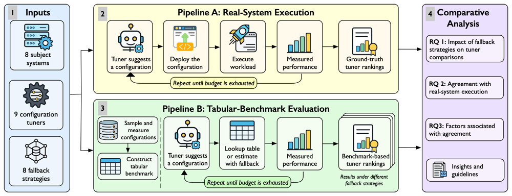

# Dataset

This project studies how fallback strategies in tabular benchmarks affect the evaluation and ranking of configuration tuners.



## Setup

Install the dependencies in a Python environment:

```sh
python -m pip install -r requirements.txt
```

Scott–Knott analysis also requires R and the `ScottKnottESD` package. The optional TabPFN service requires a separate environment with `tabpfn` installed.

## Run experiments

Run commands from the repository root. Select systems, tuners, fallback strategies, budgets, and run counts in `main.py`, then run:

```sh
python main.py
```

Dataset CSVs contain configuration options followed by the performance column. MySQL, PostgreSQL, HTTPD, and Tomcat maximize performance; the other systems minimize it.

## Project structure

| Directory | Purpose |
| --- | --- |
| `datasets/` | Tabular configuration benchmarks |
| `preprocessing/` | Sampling scripts and source tables |
| `tuner/` | Configuration tuner implementations |
| `utils/` | Configuration evaluation and experiment logging |
| `tools/` | Optional TabPFN prediction service |
| `results_dataset/`, `results_system/` | Tabular and real-system experiment results |
| `statistical_tools/` | Statistical analysis and paper figures |

## Analysis

- `statistical_tools/RQ1/scripts/`: tuner rankings, ranking agreement, and distinction analysis.
- `statistical_tools/RQ2/scripts/`: comparisons with real-system rankings.
- [RQ3](statistical_tools/RQ3/README.md): fallback reconstruction accuracy and landscape preservation.
- [Discussion](statistical_tools/discussion/README.md): system characteristics and landscape comparisons.
- [Guideline](statistical_tools/guideline/README.md): fallback selection using measured quality metrics.
- `statistical_tools/motivation/scripts/`: convergence and performance-distribution figures.

Run numbered analysis scripts in order within each research question. Review their input settings before regenerating results.
