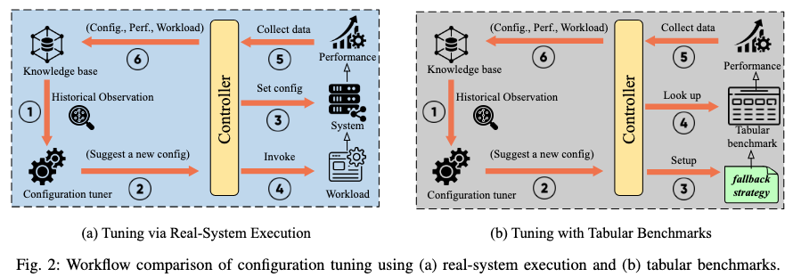
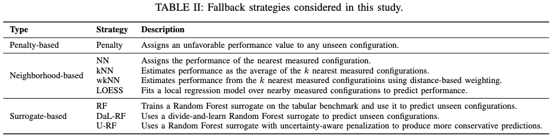
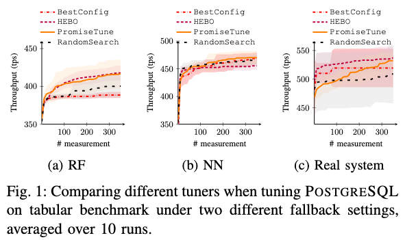
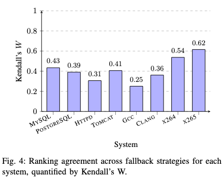
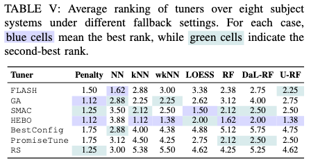
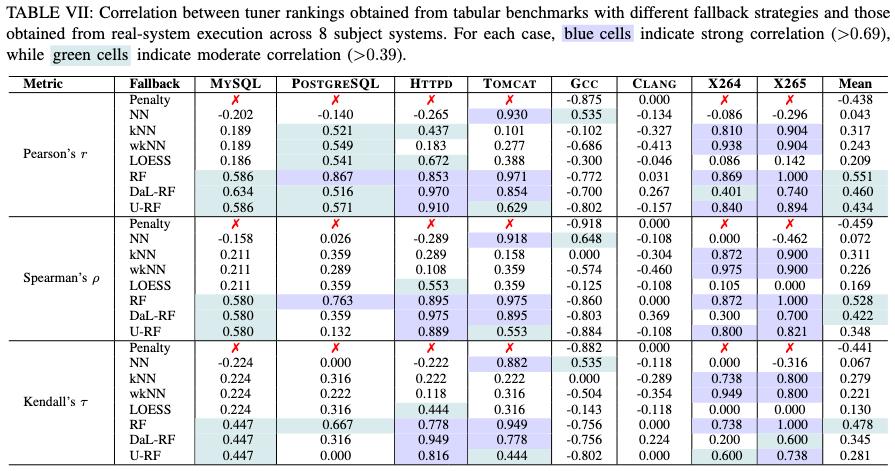

---
output:
  html_document: default
  word_document: default
  pdf_document: default
---
# Unreflected Use of Tabular Benchmarks Can Mislead the Evaluation of Configuration Tuners

---
## 1. Background

### 1.1 Conducting Tuning on real system VS. tabular benchmarks




### 1.2 Potential fallback strategies for handling missing data in tabular benchmarks




---
## 2. Motivation




### 2.1 Key Observations:
**As observed, fallback strategies can lead to different rankings of tuners (e.g., *HEBO obtains best rank under RF, while worst under NN*), which raises concerns about the reliability of conclusions drawn from tabular benchmarks. 
This motivates our investigation into the impact of fallback strategies on tuner evaluation and the need for careful consideration when interpreting results from tabular benchmarks.**

[//]: # (### 2.2 Literature Support:)

[//]: # ()
[//]: # (**Key Statement:** We empirically compare surrogate-based benchmarks to the more widely used tabular benchmarks, and demonstrate that the latter may produce unfaithful results regareding.)

[//]: # ()
[//]: # (**Tabular Benchmark:** A tabular benchmark returns function evaluations from a table of *pre-recorded performance results*. The search space is discretized and therefore be only evaluated at discrete points. &#40;NN could be simplely considered as the tabular benchmark form&#41;.)

[//]: # ()
[//]: # (**Surrogate Benchmark:** A surrogate benchmark returns predictions of models trainted to infer the functional relationship between configs and performances based on a set of *pre-recored performance results*.)

[//]: # ()
[//]: # (```bash)

[//]: # (@InProceedings{pmlr-v188-pfisterer22a,)

[//]: # (  title = 	 {YAHPO Gym - An Efficient Multi-Objective Multi-Fidelity Benchmark for Hyperparameter Optimization},)

[//]: # (  author =       {Pfisterer, Florian and Schneider, Lennart and Moosbauer, Julia and Binder, Martin and Bischl, Bernd},)

[//]: # (  booktitle = 	 {Proceedings of the First International Conference on Automated Machine Learning},)

[//]: # (  pages = 	 {3/1--39},)

[//]: # (  year = 	 {2022},)

[//]: # (  editor = 	 {Guyon, Isabelle and Lindauer, Marius and van der Schaar, Mihaela and Hutter, Frank and Garnett, Roman},)

[//]: # (  volume = 	 {188},)

[//]: # (  series = 	 {Proceedings of Machine Learning Research},)

[//]: # (  month = 	 {25--27 Jul},)

[//]: # (  publisher =    {PMLR},)

[//]: # (  pdf = 	 {https://proceedings.mlr.press/v188/pfisterer22a/pfisterer22a.pdf},)

[//]: # (  url = 	 {https://proceedings.mlr.press/v188/pfisterer22a.html},)

[//]: # (})

[//]: # (```)

---
## 3. Research Questions

1. **RQ1**: Do distinct fallback strategies lead to conflicting rankings of tuners on the same tabular benchmarks?

2. **RQ2**: Which fallback strategy most faithfully reproduces the tuner rankings observed in real-system executions?

3. **RQ3**: How does benchmark sparsity shape the conclusions produced by different fallback strategies?

---
## 4. Preliminary Experimental Results

### 4.1 Experimental Setup

1. systems: 8 systems

2. Tabular Benchmark: We sample configurations using LHS and measure them on system executions

3. Tuner: 7 representative tuners

4. Fallback Strategies: 8 different fallback strategies; When a configuration is not observed in the tabular benchmark, its performance is estimated using a fallback strategy. If exists, the observed performance is used directly without fallback.

5. All tuners are executed on the tabular benchmarks with different fallback strategies; The measurement number keeps the same for fair comparison.

6. Statistical Validation: All tuners are run 10 times independently and Scott-Knott test is used to rank tuners.

### 4.2 Measurement Details

1. **Real system execution**, where configurations are directly deployed and measured on the actual system, providing the ground-truth tuner comparison.

2. **Tabular benchmark evaluation**, where configurations are measured using tabular benchmarks. In this setting, unseen configurations are handled using different fallback strategies. Specifically, we consider eight fallback strategies, leading to eight distinct evaluation outcomes for each tuner.

---
### 4.3 RQ1: Impact of Fallback Strategies on Tuner Rankings

#### 4.3.1 Kendall's W for measuring the agreement of tuner rankings under different fallback strategies



#### 4.3.2 Top-1/Top-2 tuner difference across fallback strategies




**RQ1:** Fallback strategies can significantly influence evaluation outcomes, affecting both the relative ranking of tuners and the identification of top-performing tuners.

---
### 4.4. RQ2: Faithfulness of Fallback Strategies

#### 4.4.1 Correlation between tuner rankings from tabular benchmarks and real system execution



### RQ3: Impact of Benchmark Sparsity on Tuner Rankings

...


## References
